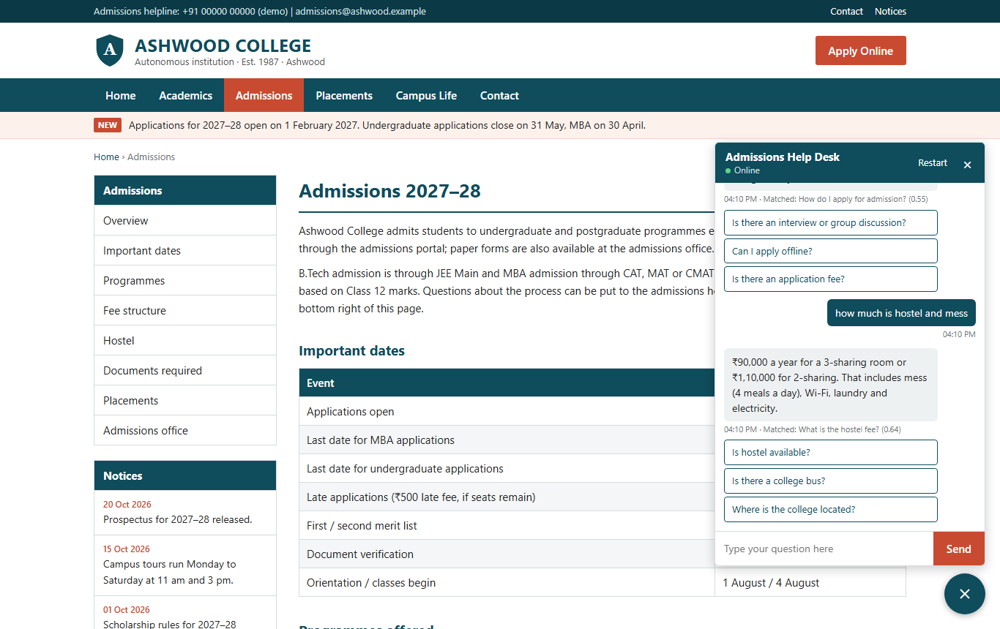

# Ashwood Admissions – FAQ Chatbot

A chatbot that answers admission questions for **Ashwood College**, a fictional college made up for this project. It runs as a help-desk chat widget on a mock admissions page of the college's website. Type a question in your own words and the bot finds the closest matching FAQ using NLP, then replies with its answer.

Built for **CodeAlpha AI Internship – Task 2**.



## Features

- 41 admission FAQs across 9 topics (applying, eligibility, courses, fees & scholarships, hostel & campus, documents, dates, placements, contact), plus small talk like "hi" and "thanks"
- Understands different wordings of the same question ("how much is hostel and mess" → *What is the hostel fee?*)
- Shows which FAQ it matched and the similarity score
- When it isn't sure, it says so and suggests the closest questions instead of guessing
- Follow-up suggestions after every answer, never repeating a question already asked in the chat
- "Browse all topics" inside the chat lists every FAQ by topic (questions already asked are greyed out)
- Links on the admissions page (Apply Online, eligibility, scholarships…) open the chat and ask that question
- Works on phones, where the chat opens full screen

## How it works

```
"how much is hostel and mess?"
        │
        ▼
1. Preprocess (nlp.py, NLTK)
   lowercase → tokenize → drop punctuation → remove stopwords
   → stem → map synonyms                          ["much", "hostel", "mess"]
        │
        ▼
2. TF-IDF vector (tfidf.py): single words + adjacent word pairs
        │
        ▼
3. Cosine similarity against every phrasing of every FAQ
        │
        ▼
4. Best score ≥ 0.45  →  answer that FAQ                (here: 0.64)
   Best score < 0.45  →  "Did you mean…" with the 3 closest questions
   Nothing close      →  "Sorry, I don't have an answer for that"
```

**Preprocessing** (`nlp.py`) uses NLTK's `word_tokenize`, its English stopword list and the Snowball stemmer, so *applying / applied / application* all become `appli`. It also:
- normalises degree names (*B.Tech*, *b. tech* → `btech`) and *Wi-Fi* / *wifi*
- maps common synonyms (*cost*, *price*, *charges* → `fee`; *accommodation* → `hostel`)
- drops filler words that say nothing about the topic (*please*, *tell*, *college*)

**TF-IDF and cosine similarity** (`tfidf.py`) are written out in about 20 lines of plain Python rather than imported, so the maths is easy to follow. Each term gets the weight `(1 + log count) × idf`, where `idf = log((1 + N) / (1 + document frequency)) + 1`, so words that appear in few questions count for more. Vectors are scaled to length 1, which makes cosine similarity a dot product.

**Matching** (`chatbot.py`) indexes every question and its alternative phrasings from `data/faqs.json` (190 phrasings in total). Each FAQ's score is its best-matching phrasing. Small talk only counts when it's a near-exact match (≥ 0.7), so "recommend a good movie" doesn't get "Hi!" back because of "good morning".

## Accuracy

Measured with the test suite on questions worded differently from the FAQ file:

| Question set | Answered correctly | Right question answered or suggested |
|---|---|---|
| 30 paraphrases used while tuning | 30 / 30 | 30 / 30 |
| 22 questions never used for tuning | 19 / 22 (86%) | 22 / 22 |

Unrelated questions ("who won the cricket match") get no answer rather than a wrong one.

## Getting started

**Requirements:** Python 3.10+.

```bash
# 1. Clone the repository
git clone https://github.com/Manav-31/CodeAlpha_FAQChatbot.git
cd CodeAlpha_FAQChatbot

# 2. Create and activate a virtual environment
python -m venv venv
venv\Scripts\activate          # Windows
# source venv/bin/activate     # macOS / Linux

# 3. Install dependencies
pip install -r requirements.txt

# 4. Run the app
python app.py
```

Open **http://127.0.0.1:5000** in your browser. On first run the app downloads two small NLTK data packages (the tokenizer and stopword list). Set `PORT` to use a different port.

## Running the tests

```bash
pip install -r requirements-dev.txt
pytest
```

The 61 tests cover preprocessing, the TF-IDF maths, matching accuracy, suggestions and the web API.

## Adding or changing FAQs

Edit `data/faqs.json`. Each entry looks like this:

```json
{
  "category": "Hostel & campus",
  "question": "What is the hostel fee?",
  "variants": ["How much does the hostel cost?", "Hostel and mess charges"],
  "answer": "₹90,000 a year for a 3-sharing room..."
}
```

`variants` are other ways people ask the same thing; adding a few makes matching noticeably better. Restart the app after editing.

## API

`POST /api/chat`

```json
// Request ("asked" is optional: questions already answered in this chat, which won't be suggested again)
{ "message": "how much is hostel and mess", "asked": ["Is hostel available?"] }

// Response 200
{
  "answer": "₹90,000 a year for a 3-sharing room or ₹1,10,000 for 2-sharing. That includes mess (4 meals a day), Wi-Fi, laundry and electricity.",
  "matched_question": "What is the hostel fee?",
  "category": "Hostel & campus",
  "score": 0.64,
  "suggestions": ["Is there a college bus?", "Where is the college located?", "What facilities are on campus?"]
}
```

## Project structure

```
CodeAlpha_FAQChatbot/
├── app.py               # Flask server and routes
├── chatbot.py           # Matching logic, thresholds and replies
├── tfidf.py             # TF-IDF vectors and cosine similarity
├── nlp.py               # NLTK preprocessing
├── data/
│   └── faqs.json        # Questions, alternative phrasings and answers
├── templates/
│   └── index.html       # Page layout
├── static/
│   ├── style.css
│   ├── script.js        # Chat behaviour
│   └── favicon.svg
├── tests/               # pytest suite
├── docs/
│   └── screenshot.png
├── requirements.txt
├── requirements-dev.txt # Adds pytest
└── pytest.ini
```

## Note

Ashwood College, its fees, dates, contact details and placement figures are all made up for this demo.
